# Top-tier Zone! A fault identification program based on 1D-2D-DCGAN-ResNet-MSA. Ultra-innovative! After watching, you can write a paper right away!

Applicable Platform: Matlab2023 version and above
References:
Reference Two: Top Chinese EI journal "Power Grid Technology" document: "Affectation Prediction Method of Power Distribution Network Based on Data Augmentation".
Reference Three: Top Chinese EI journal "China Electric Machinery and Electrical Engineering" recent publication document: "Energy Quality Disturbance Identification Method Based on Combining Feature Images and Improving ResNet-18".
For fault identification model, the reference three adopts the well-known ResNet as the framework for fault identification model, and then improves it based on multihead self-attention mechanism (MSA) to enhance the feature extraction capability of the model;
In terms of data preprocessing, the reference one uses a method of converting one-dimensional time series into images using 1D time-series to image conversion method.
For categories with imbalanced samples or few samples, the reference two uses DCGAN deep convolutional adversarial generation algorithm to generate massive samples from a small number of samples batch by batch!
Document One Interpretation
Document Two Interpretation
Document Three Interpretation
The innovation of Reference Three is that it adopts a more novel residual module in building the network, as shown in the figure below. The residual module adds a bypass branch on the single convolution path, making the output of subsequent layers depend on the input of the previous layer. ResNet leverages the special structure of multiple residual modules to greatly reduce its parameter size, alleviate network degradation issues, and facilitate the extraction of deep features in images. This paper implements multihead self-attention (MSA) mechanism embedded in the basic implementation of ResNet from Reference Three, enhancing feature extraction and improving the accuracy of fault identification.
Based on the one-dimensional time series to two-dimensional image conversion method from literature 1, this paper transforms Xichu University bearing diagnostic data into two-dimensional recursive images. Combining with literature 2, for fault categories with few samples, a DCGAN adversarial generation is adopted and batch sample enhancement is implemented. Furthermore, combining with literature 3, a ResNet-MSA model is constructed to realize bearing fault diagnosis, achieving a complete linkage from 1D vibration signal to multi-scale RP image generation to DCGAN sample expansion to ResNet-MSA classification: a fault recognition program based on transfer learning using 1D-2D-RP-DCGAN-ResNet-MSA, which is innovative and sufficient to support a high-level academic paper or simple tasks such as graduation projects.
This paper's model
1D-2D-RP-DCGAN-ResNet-MSA fault recognition program
·Only raw fault waveform data is required to convert a one-dimensional sequence into a two-dimensional recursive image according to the waveform data.
·For fault categories with few samples, a DCGAN is used to achieve sample enhancement.
·An improvement to the fault recognition network is made by incorporating a multi-head self-attention mechanism MSA layer to implement fault recognition.
Innovation points:
1. For the first time, it proposes the integration of signal transformation (RP), sample enhancement (DCGAN), and classification model (ResNet-MSA), which has extremely high innovation.
2. Time series imageization: It converts a one-dimensional time series signal into a two-dimensional image, thereby more comprehensively describing the characteristics of the data. This helps to extract richer and more discriminative features, thus improving the accuracy of classification and recognition.
5. The dataset uses the Xichu University public dataset, with an accuracy that approaches 100%, ready for direct writing a paper!!! No one has ever done it before!
6. t-SNE visualization of the decision process, a top journal's preferred feature visualization tool in papers, resulting in very beautiful graphs that leave a good impression on experts and readers, which is an essential tool for scientific research!
7. Extensive analysis results, substantial workload, top journals' choice
Applicable Fields: Suitable for various data classification scenarios, such as rolling bearing faults, transformer oil and gas faults, power system transmission line fault diagnosis, static and transient voltage stability assessment, insulators, distribution networks, and disturbances to power quality. Can be used for identification, diagnosis, and classification in these fields. Simply replace the data directly, using an Excel sheet for import without needing significant modifications to the program. The program includes detailed comments for ease of understanding the program's operation. Data format: Each row represents a sample, with the last column being the label of the fault type associated with the sample.
Program Results: (The above one-dimensional sequence is automatically converted into a recursive graph RP image)
Program Results:

## Images

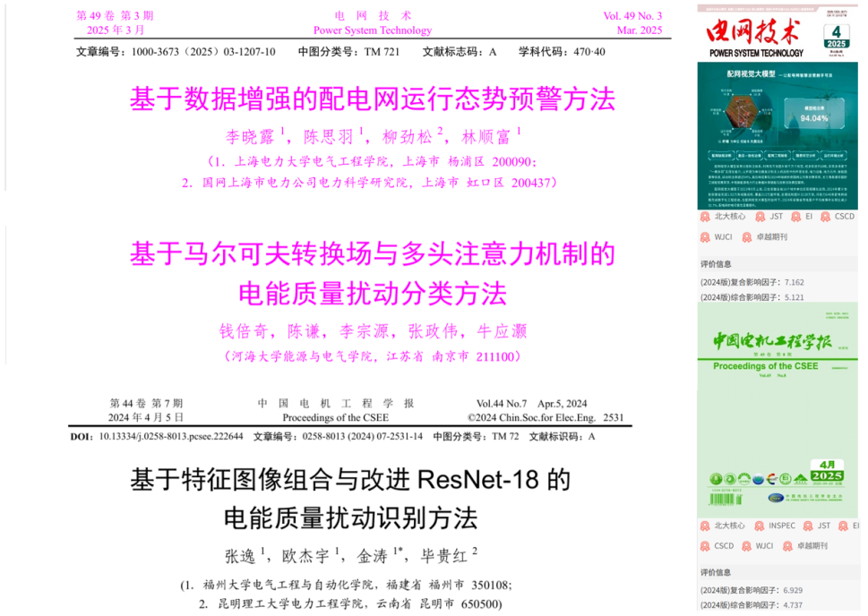
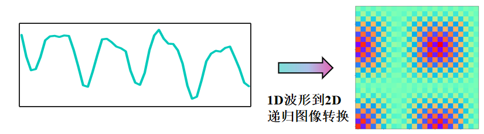
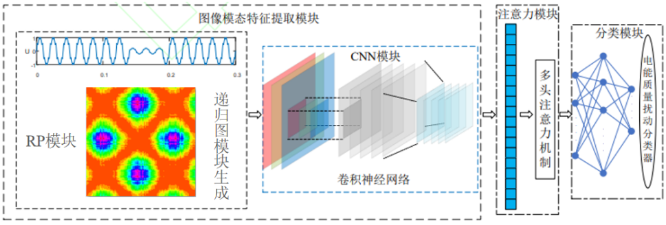
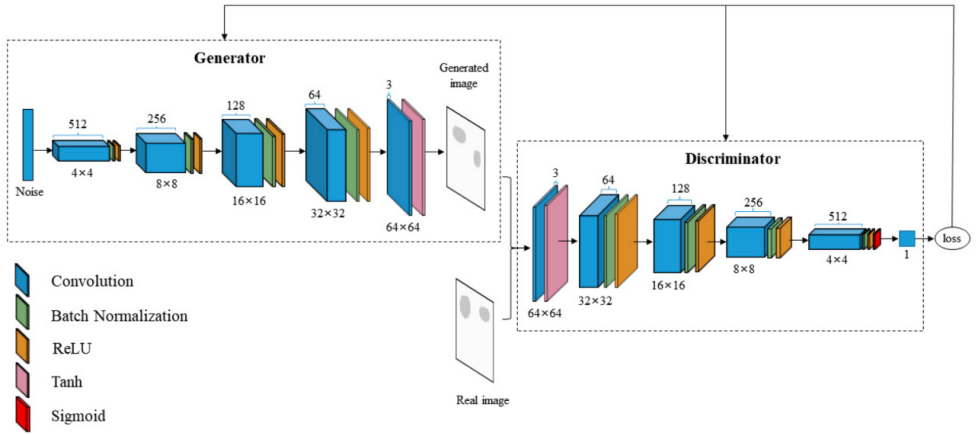
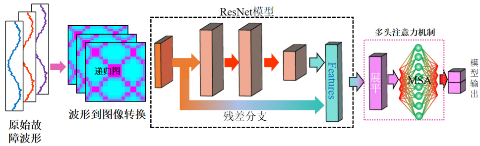
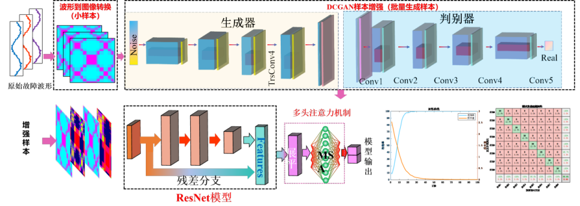
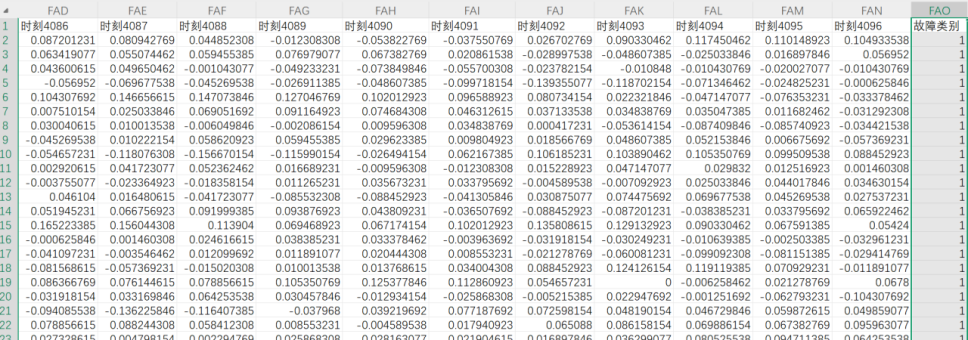
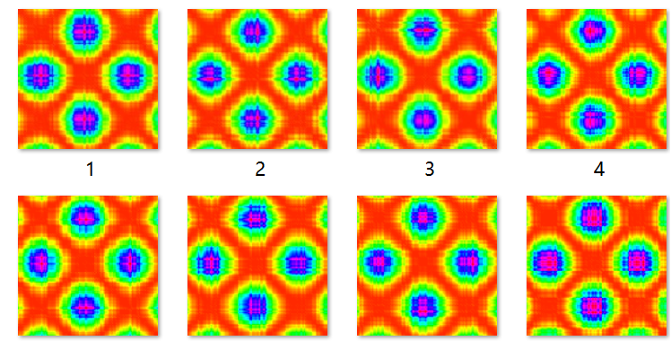
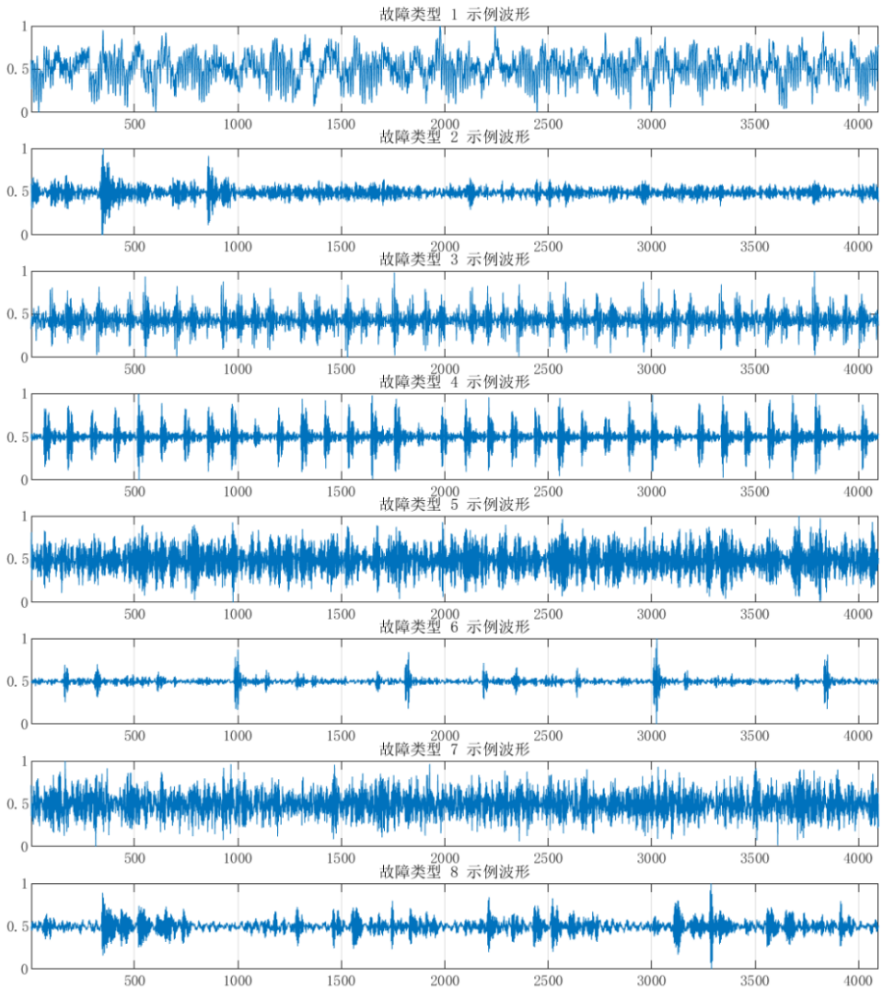
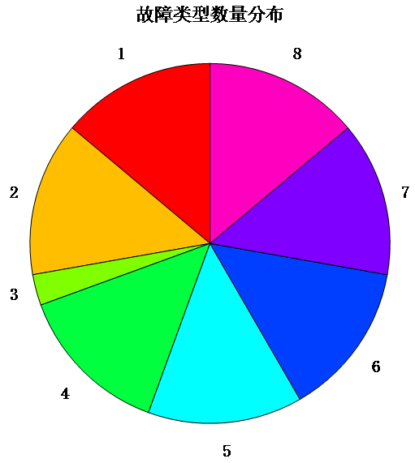
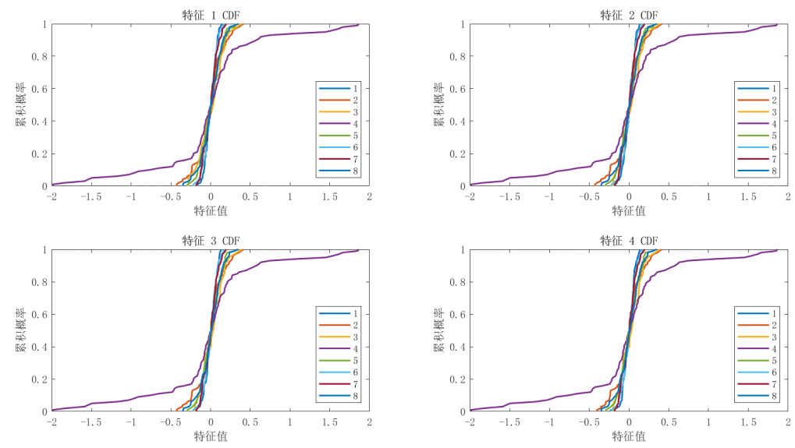
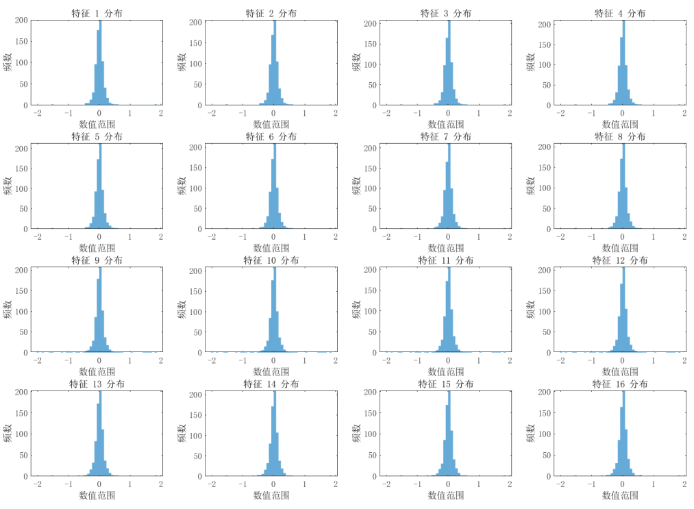
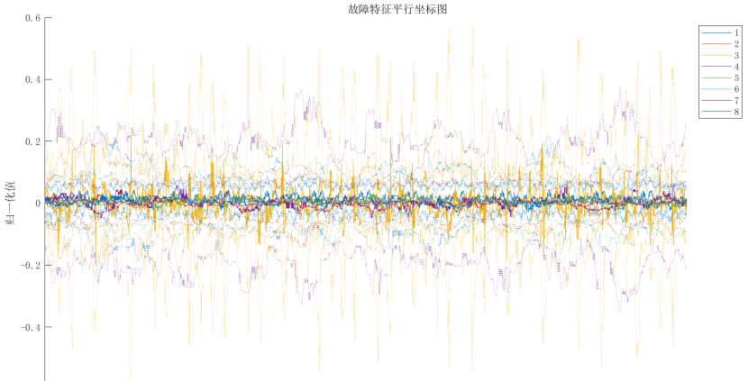
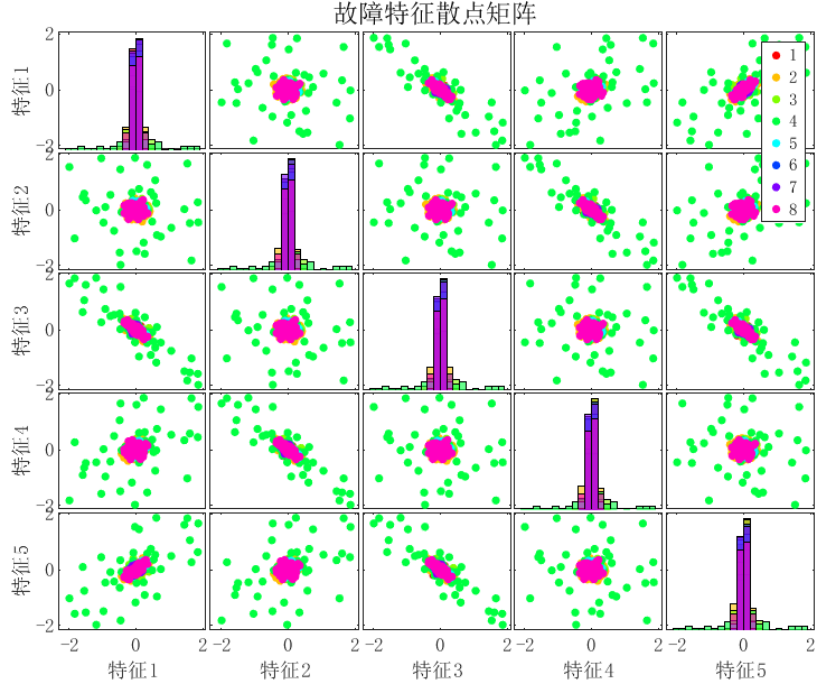
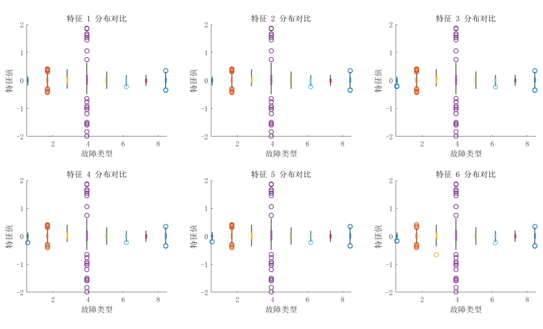
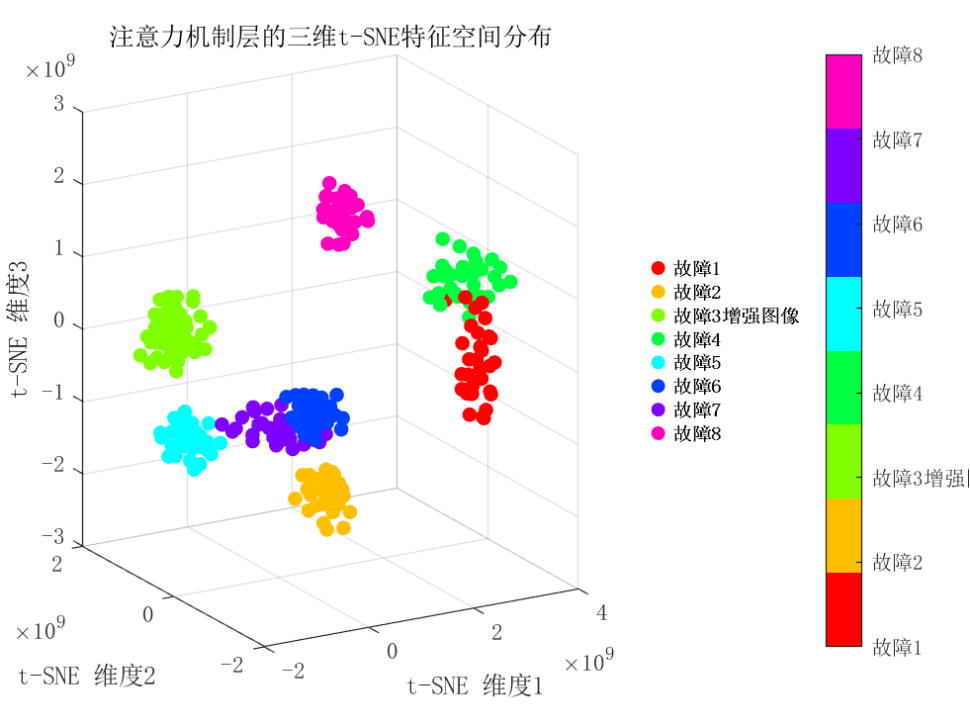
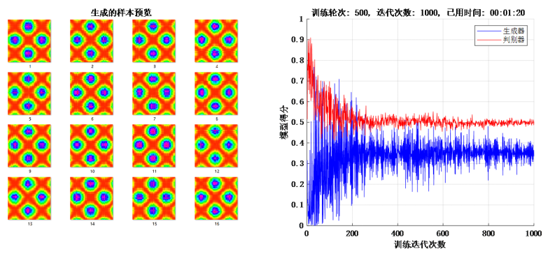
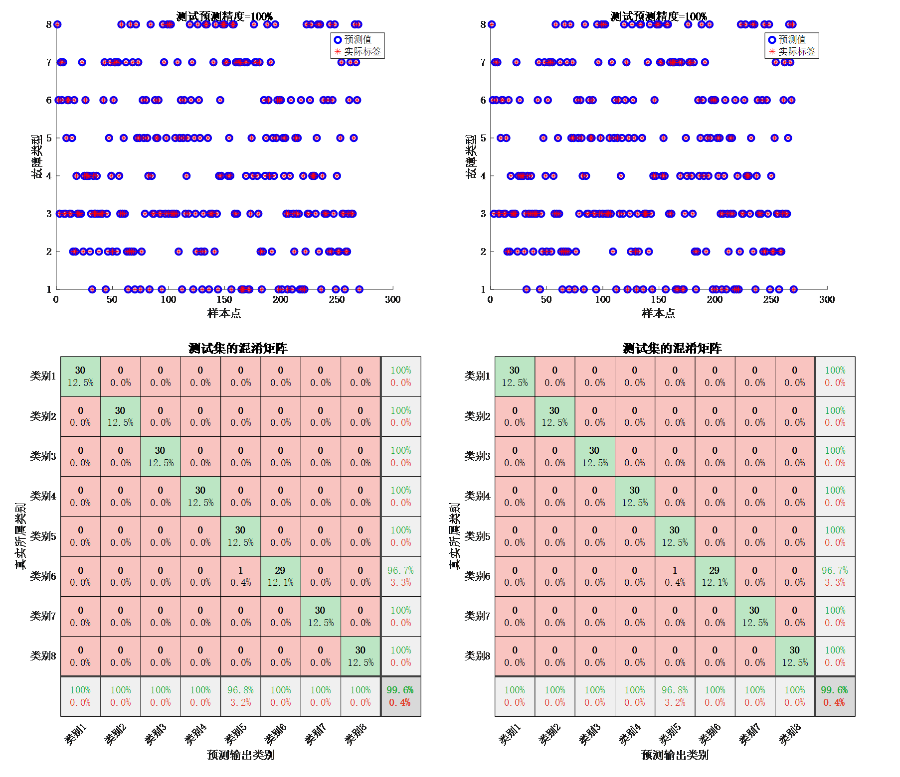
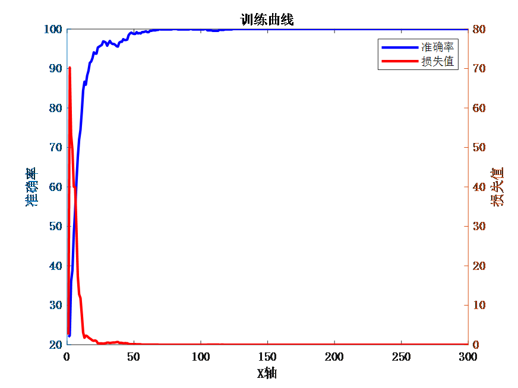

<!-- PAYMENT_BLOCK -->

## Get this dataset

- Payment link (Stripe): [Buy now](https://buy.stripe.com/3cs8yP7sY87d0vu9AB)
- Payment QR code: 

<!-- /PAYMENT_BLOCK -->
